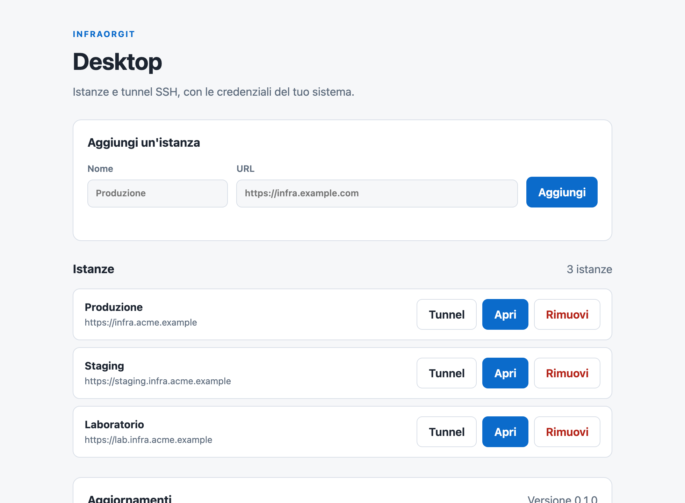

# InfraOrgIT Desktop

InfraOrgIT Desktop opens one or more InfraOrgIT instances in their own
windows and brings the instance's SSH targets to your machine. It uses the
operating-system webview and your existing SSH agent: no separate browser, no
private key copied into the app.

## What you can do

- **Several instances, separate windows.** Keep production, staging and a lab
  open at the same time; each window has its own session and cookies.
- **Tunnels with your SSH agent.** Open `ssh -L` (local), `-D` (SOCKS) and
  `-R` (remote) forwards, including jump-host chains supplied by the instance.
- **Services per server.** The tunnel panel lists the server's deployments and
  custom services (local HTTP/HTTPS, SOCKS, remote), with a local port and an
  **Open** button while a tunnel is active.
- **Start once, reconnect if needed.** Services marked `autoStart` start when
  the target list loads. If an `autoStart` SSH process exits unexpectedly, the
  app reconnects up to three times, five seconds apart, reusing the same local
  port. A manual stop cancels the retries.
- **Keycloak or a personal token.** Sign in with the OAuth device grant, or
  paste a token with `tunnels:operate`. The access token stays in memory; the
  refresh token goes to the OS secret store.
- **Restore after restart.** Saved tunnels reopen after the manager page loads
  when the stored session is still valid. No token, host, username or secret is
  written to the tunnel file.
- **Signed updates.** The app reads the latest GitHub release, downloads the
  archive for the current platform only from GitHub, verifies the signed
  SHA-256 manifest and installs or opens the installer.

## Install

Download the archive for your platform from the
[Releases](https://github.com/SenseiKiritof/InfraOrgITDesktop/releases) page:

| Platform | Archive |
|---|---|
| macOS Apple silicon | `InfraOrgIT-Desktop-<version>-osx-arm64.zip` |
| macOS Intel | `InfraOrgIT-Desktop-<version>-osx-x64.zip` |
| Windows x64 | `InfraOrgIT-Desktop-<version>-win-x64.zip` |
| Linux x64 | `InfraOrgIT-Desktop-<version>-linux-x64.tar.gz` |

If the Releases page does not have a build yet, [`docs/DEVELOPMENT.md`](docs/DEVELOPMENT.md)
describes how to build and package it from source.

- **macOS**: unzip, move `InfraOrgIT Desktop.app` to Applications and open it.
  A build without a Developer ID signature requires the usual right-click →
  **Open** confirmation; the release notes state whether the build is signed
  and notarized.
- **Windows**: unzip and run `InfraOrgIt.Desktop.exe`. An unsigned build may
  show SmartScreen; use **More info → Run anyway** only if you trust the
  release.
- **Linux**: extract the archive and run `InfraOrgIt.Desktop`. The system
  webview needs WebKitGTK (`libwebkit2gtk-4.1-0` on Debian/Ubuntu).

The app also needs the OpenSSH client and a running SSH agent. Load your key
with `ssh-add` before opening a tunnel; the app never reads private keys.

## Use it

1. Add an instance: a name and the HTTPS URL of your InfraOrgIT installation.
2. **Open** launches the instance in its own window.
3. **Tunnel** opens the panel for that instance. Sign in with Keycloak or paste
   a personal token with `tunnels:operate`.
4. Pick a server, a deployment or a custom service, optionally change the local
   port, and press **Open** or **Start**.
5. Use **Open** next to an active local HTTP/HTTPS tunnel to launch it in the
   browser. **Close** stops the forward.

The panel shows the active tunnels and their live state. The same sessions are
visible to the team on the instance's **Tunnels** page.

## Security

- The refresh token is stored in macOS Keychain, Windows Credential Manager or
  the Linux Secret Service. Access tokens live only in memory.
- On macOS the token is written through the native Security framework, never
  as a process argument.
- Remote instance URLs must use HTTPS; plain HTTP is accepted only for
  loopback development, unless the explicit development override is set.
- The app reads the SSH configuration and lets the system `ssh` use the agent;
  it does not store private keys.
- Updates require a valid signed manifest; a missing or invalid signature
  blocks automatic installation and offers only a manual download.

## Learn more

- [AllInfraOrgIT](https://github.com/SenseiKiritof/AllInfraOrgIT) — product,
  deployment and architecture.
- [`../AllInfraOrgIT/docs/architecture/mcp-server-and-tunnels.md`](../AllInfraOrgIT/docs/architecture/mcp-server-and-tunnels.md)
  — MCP and tunnel design.
- [`docs/DEVELOPMENT.md`](docs/DEVELOPMENT.md) — build, run from source,
  packaging, signing, update internals and tests.
