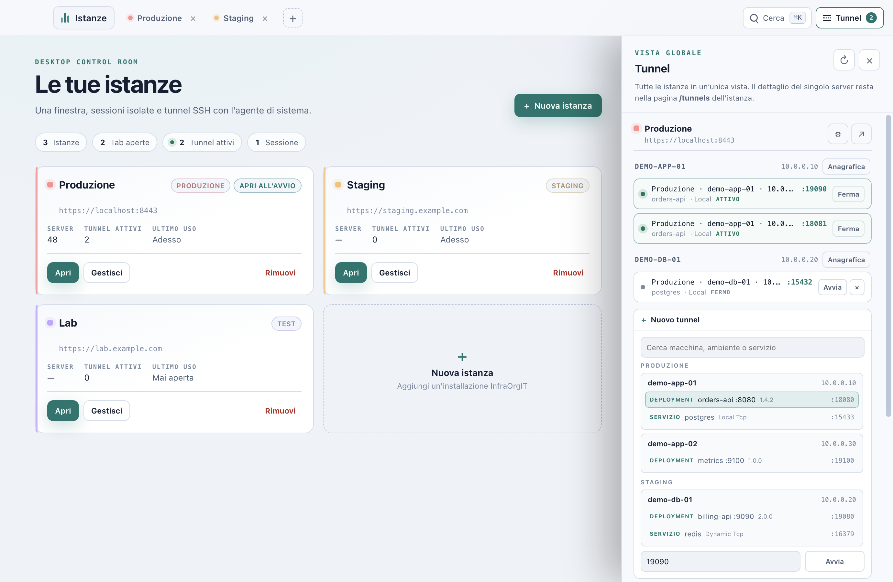
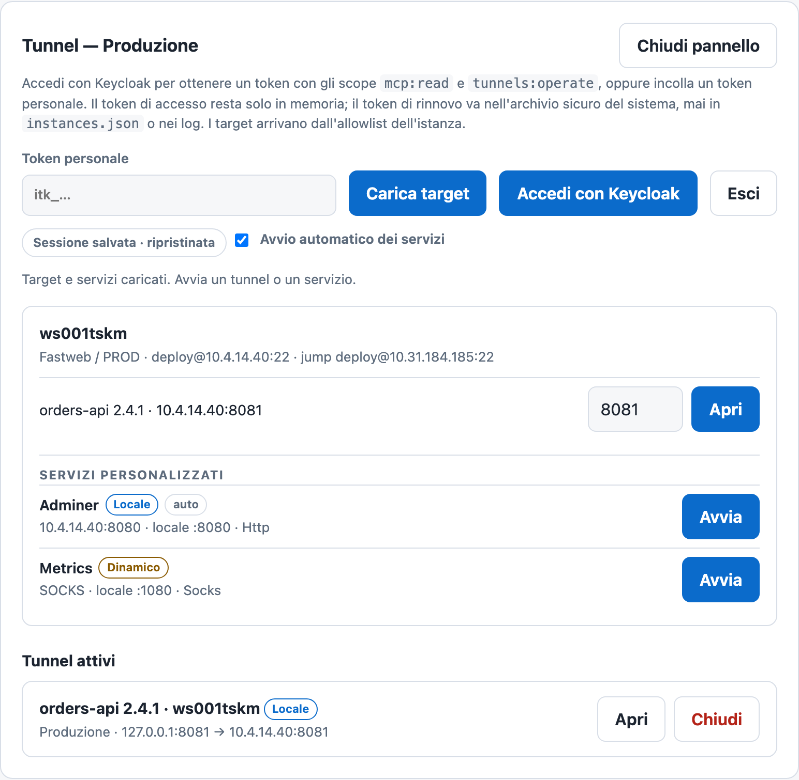

# InfraOrgIT Desktop

InfraOrgIT Desktop opens one or more InfraOrgIT instances from a single
control-room window. The current Electron shell uses one tab per instance,
reuses the instance BFF session for tunnel access and inherits the account
theme. It drives your existing SSH agent, so no private key is copied into the
app.

The screenshots use fictitious demo instances, servers and tunnels.

> The Electron shell in [`prototype-electron/`](prototype-electron/README.md)
> is packaged locally for testing. The signed archives below still refer to the
> Photino build until Electron signing and notarization are released.

## Electron shell

- **Landing manager.** Instance cards with name, URL, environment, last use,
  server count and tunnel count; **Nuova istanza**, **Apri**, **Gestisci** and
  **Rimuovi**. **Istanze** is always one click away from an open tab.
- **Isolated tabs.** Each instance URL has its own persistent Chromium
  partition, so cookies and the BFF login never cross instances.
- **One tunnel drawer for every instance.** Rows are grouped by instance and
  server and show the local port. The **Nuovo tunnel** form searches by machine,
  IP, environment, application and service, while keeping the environment
  groups.
- **One theme.** The shell follows the light/dark preference of the signed-in
  account. The Web app toggle is the only control; there is no separate desktop
  theme button.
- **Session reuse.** When the instance tab is already signed in, the desktop
  uses that BFF session for the tunnel API. It falls back to the device flow or
  a personal `tunnels:operate` token only when no web session is available.

## What you can do

The list below describes the current Photino release; the Electron shell above
adds the landing manager, isolated tabs, the searchable multi-instance tunnel
drawer and the shared account theme.

- **Several instances, separate windows.** Keep production, staging and a lab
  open at the same time. Each window keeps its own navigation and session
  state; on Windows each instance also gets a separate webview data folder.
  macOS and Linux still share the webview data store, so two instances on the
  same host can share the login cookie.
- **Tunnels with your SSH agent.** Open `ssh -L` (local), `-D` (SOCKS) and
  `-R` (remote) forwards, including jump-host chains supplied by the instance.
- **Services per server.** The tunnel panel lists the server's deployments and
  custom services (local HTTP/HTTPS, SOCKS, remote), with a local port and an
  **Open** button while a tunnel is active.
- **Start once, reconnect if needed.** Services marked `autoStart` start when
  the target list loads. If an `autoStart` SSH process exits unexpectedly, the
  app reconnects up to three times, five seconds apart, reusing the same local
  port. A manual stop cancels the retries.
- **Keycloak or a personal token.** Sign in with the OAuth device grant, or
  paste a token with `tunnels:operate`. The access token stays in memory; the
  refresh token goes to the OS secret store.
- **Restore after restart.** Saved tunnels reopen after the manager page loads
  when the stored session is still valid. No token, host, username or secret is
  written to the tunnel file.
- **Signed updates.** The app reads the latest GitHub release, downloads the
  archive for the current platform only from GitHub, verifies the signed
  SHA-256 manifest and installs or opens the installer.

## Install

Download the archive for your platform from the
[Releases](https://github.com/SenseiKiritof/InfraOrgITDesktop/releases) page:

| Platform | Archive |
|---|---|
| macOS Apple silicon | `InfraOrgIT-Desktop-<version>-osx-arm64.zip` |
| macOS Intel | `InfraOrgIT-Desktop-<version>-osx-x64.zip` |
| Windows x64 | `InfraOrgIT-Desktop-<version>-win-x64.zip` |
| Linux x64 | `InfraOrgIT-Desktop-<version>-linux-x64.tar.gz` |

If the Releases page does not have a build yet, [`docs/DEVELOPMENT.md`](docs/DEVELOPMENT.md)
describes how to build and package it from source.

- **macOS**: unzip, move `InfraOrgIT Desktop.app` to Applications and open it.
  A build without a Developer ID signature requires the usual right-click →
  **Open** confirmation; the release notes state whether the build is signed
  and notarized.
- **Windows**: unzip and run `InfraOrgIt.Desktop.exe`. An unsigned build may
  show SmartScreen; use **More info → Run anyway** only if you trust the
  release.
- **Linux**: extract the archive and run `InfraOrgIt.Desktop`. The system
  webview needs WebKitGTK (`libwebkit2gtk-4.1-0` on Debian/Ubuntu).

The app also needs the OpenSSH client and a running SSH agent. Load your key
with `ssh-add` before opening a tunnel; the app never reads private keys.

## Use it (Photino release)

1. Add an instance: a name and the HTTPS URL of your InfraOrgIT installation.
2. **Open** launches the instance in its own window.
3. **Tunnel** opens the panel for that instance. Sign in with Keycloak or paste
   a personal token with `tunnels:operate`.
4. Pick a server, a deployment or a custom service, optionally change the local
   port, and press **Open** or **Start**.
5. Use **Open** next to an active local HTTP/HTTPS tunnel to launch it in the
   browser. **Close** stops the forward.

The panel shows the active tunnels and their live state. The same sessions are
visible to the team on the instance's **Tunnels** page.

## Downloads

The manager's **Download** setting chooses how files from an instance are
saved:

- **Automatico**: uses the native webview on Windows, or on macOS when the
  patched Photino library is present; otherwise the managed bridge.
- **Bridge**: asks the instance for a short-lived one-time ticket and downloads
  it in the desktop process. This works on every platform and keeps the app
  responsive while the server is slow.
- **Nativo**: lets Windows WebView2 or the patched macOS webview handle server
  attachments directly. It is available only when the platform supports it;
  generated API results still use the bridge.

The desktop runs downloads in the background, shows queued/running/completed
state and sends a native notification at the end. A slow server or a large file
never blocks the app window.

## Security

- The refresh token is stored in macOS Keychain, Windows Credential Manager or
  the Linux Secret Service. Access tokens live only in memory.
- On macOS the token is written through the native Security framework, never
  as a process argument.
- Remote instance URLs must use HTTPS; plain HTTP is accepted only for
  loopback development, unless the explicit development override is set.
- The app reads the SSH configuration and lets the system `ssh` use the agent;
  it does not store private keys.
- Updates require a valid signed manifest; a missing or invalid signature
  blocks automatic installation and offers only a manual download.

## Learn more

- [AllInfraOrgIT](https://github.com/SenseiKiritof/AllInfraOrgIT) — product,
  deployment and architecture.
- [`../AllInfraOrgIT/docs/architecture/mcp-server-and-tunnels.md`](../AllInfraOrgIT/docs/architecture/mcp-server-and-tunnels.md)
  — MCP and tunnel design.
- [`docs/DEVELOPMENT.md`](docs/DEVELOPMENT.md) — build, run from source,
  packaging, signing, update internals and tests.
