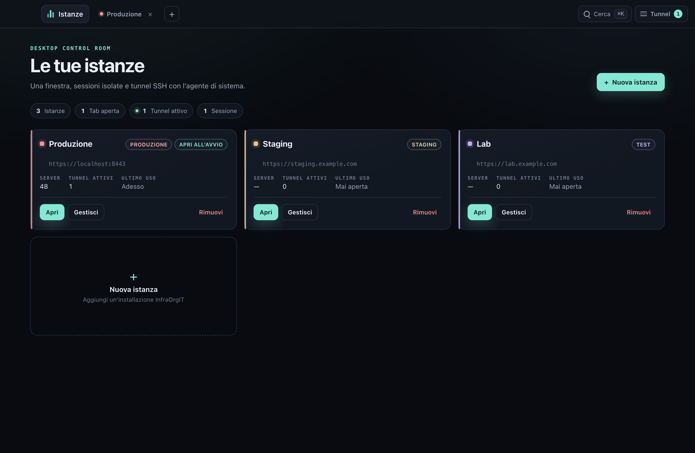
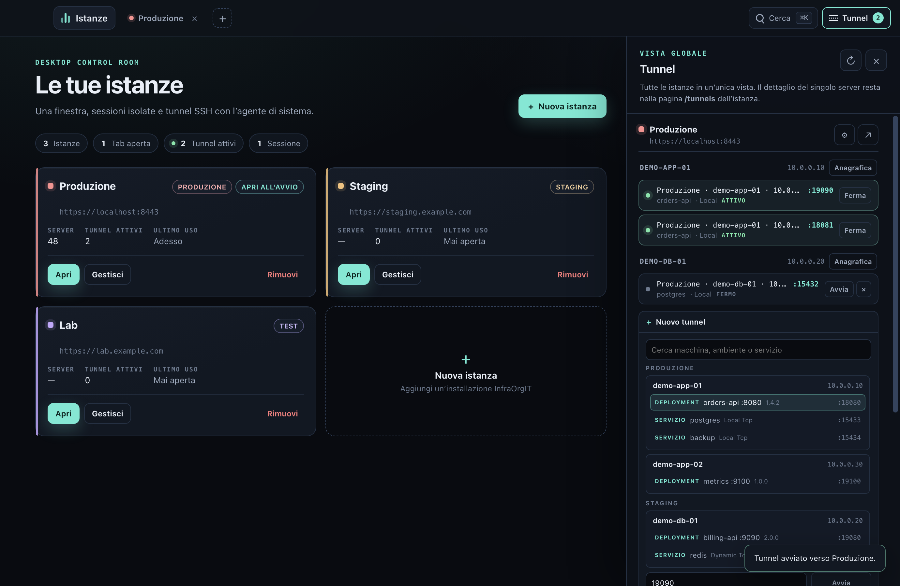
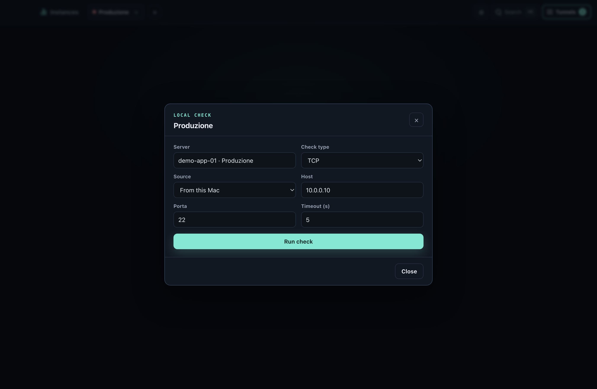

# InfraOrgIT Desktop

InfraOrgIT Desktop is the Electron app in [`electron/`](electron/README.md). It
opens one or more InfraOrgIT instances from a single control-room window, reuses
the instance BFF session and drives the local SSH agent. For server credentials
downloaded from the web app it keeps only device-encrypted payloads and decrypts
them in memory; no SSH private key is copied into a command line, renderer or
log.



The screenshots use fictitious demo instances, servers and tunnels.

## Features

- **Languages.** The manager and tunnel drawer are English by default. The
  Settings dialog switches to Italian, French, German or Spanish; the choice is
  stored locally, and missing strings fall back to English.
- **Landing manager.** Instance cards show name, URL, environment, last use,
  server count and tunnel count. **New instance**, **Open**, **Manage** and
  **Remove** are in the card; **Instances** is always one click away from a tab.
  The top **+** opens a configured connection and offers **New connection**.
- **Isolated tabs.** Each instance URL has its own persistent Chromium
  partition. Cookies, the BFF login and storage never cross instances.
- **Tunnel drawer.** Rows are grouped by instance and server and show the local
  port. A search filters instances, servers and tunnels, and every instance and
  server group collapses or expands independently. **Nuovo tunnel** searches by machine, IP,
  environment, application and service, keeping the environment groups. Start,
  stop, error and a 30-second heartbeat are projected to the central `/tunnels`
  page.
- **Connection policy.** Each installation chooses whether tunnels are opened
  by the server (`Server`), directly by the desktop (`Client`) or automatically
  (`Auto`, the default). See [Connection mode](#connection-mode).
- **Credential distribution.** Each desktop enrolls an RSA-3072 key and
  downloads credentials encrypted for that device; a credential is shared or
  owned by a user, with optional offline storage controlled per credential.
  Downloaded credentials are used in memory for console, SFTP/files, actions and
  `Local` Client tunnels, including password credentials; `Dynamic` and `Remote`
  tunnels still require an agent key. A credential version change invalidates
  the cached copy, and revoking a device clears its secrets. Admin fields and the
  device list are on `/credentials`.
- **Offline mode.** If the instance is unreachable, the manager keeps the last
  encrypted inventory and still opens Client tunnels; downloaded credentials
  allow password tunnels too. Local TCP, TLS and HTTP checks run from this Mac or
  through the first jump host, with a searchable server autocomplete. Results
  and offline tunnel events sync to the central audit when the instance returns.
  Cached data and unsynced events are removed on logout or instance removal;
  offline credential copies exist only when `AllowOffline` is enabled.
- **Updates.** The shell checks the latest GitHub release on startup and every
  six hours; the top bar shows **Aggiorna <version>** and **Impostazioni →
  Aggiornamenti** checks, downloads, verifies and installs the package.
- **Download folder and progress.** Native downloads, generated files and SFTP
  saves use the folder chosen in **Impostazioni → Cartella download** (user's
  Downloads by default). The manager and the Web file browser show bytes and
  percentage for downloads and uploads.
- **Clean shutdown.** Quit (⌘Q or equivalent) stops every tunnel, closes relay
  sockets and console shells, then publishes the stopped sessions before the
  process exits.
- **Session reuse.** Sign-in uses the device flow with `offline_access`; the
  offline token is stored per Keycloak issuer, so instances backed by the same
  realm sign in once and the desktop session lasts `Auth:DesktopSessionDays`.
  An existing BFF session, or a personal `tunnels:operate` token, is reused as
  a fallback.
- **One theme.** The shell follows the account theme. The Web toggle is the
  only control and cycles light, dark and system; the shell follows the
  resolved appearance. There is no desktop theme button.
- **Web workspace in a tab.** Server detail, SSH console, SFTP/FTPS/FTP file
  sessions and tunnel anagrafica stay in the existing Web app. The desktop adds
  the native window, instance management and the process-level tunnel manager.



Local checks use the same searchable server field: type to filter the cached
servers, pick one and the host/port prefill; the check runs from this machine or
through the first jump host.



## Keyboard

| Shortcut | Action |
|---|---|
| ⌘N / Ctrl+N | Open the connection picker: a configured instance or **Nuova connessione** |
| ⌘T / Ctrl+T | Open or close the tunnel drawer |
| ⌘K / Ctrl+K | Command palette |
| ⌘0 / Ctrl+0 | Back to the instances landing |

## Connection mode

`SystemAdmin` sets one mode per installation in the Web app at
**Impostazioni** (`/settings`). The default is **Auto**.

| Mode | What the desktop does | Limits |
|---|---|---|
| **Auto** (default) | Tests the first SSH hop. If the client reaches it **and** a key-based agent or a downloaded credential is available, runs tunnels, console, files and actions locally; otherwise uses the server. A password credential without a downloaded copy relays. | Fast path when the network allows it; falls back automatically behind NAT/firewalls. |
| **Server** | Binds the local port and relays each tunnel connection to the API over WebSocket. The API opens SSH with the stored server credential; console, files and actions also run on the API. | Only `Local` services and deployments with a fixed target port. `Dynamic` and `Remote` tunnels are unavailable. |
| **Client** | Runs ssh2/OpenSSH with the local agent or the downloaded credential for tunnels, console, files and actions. | `Local` works with either source; `Dynamic` and `Remote` require an agent key. No server relay. Direct uploads are capped at 8 MB. |

The mode is stored in the shared MySQL database (`ConnectionPolicies`), so all
API nodes in a cluster apply the same value. Relay connections are node-local;
each local TCP connection opens its own WebSocket, so no sticky sessions are
needed, only WebSocket upgrade support on the load balancer. The central
`/tunnels` page shows the actual transport (`Client` or `Server`) of every
active session; direct console and action runs appear in the execution log,
and direct file operations in the audit log.

## Run locally

Requirements: Node 24+, npm, the OpenSSH client and either an SSH agent or
downloaded credentials (the agent is still required for key-based jumps and
`Dynamic`/`Remote` tunnels), plus an InfraOrgIT instance. For the local full
stack, `make full` from `AllInfraOrgIT` serves `https://localhost:8443`.

```bash
cd electron
npm install
npm start
```

Packaged builds require the local Caddy certificate to be trusted by macOS. In
development the shell can accept loopback certificates;
`DESKTOP_ALLOW_INSECURE_LOCALHOST=1` is the explicit override for a packaged
local test.

Sign-in uses the Keycloak device flow by default: the system browser confirms
the code and the app stores an offline token, so the desktop session survives
restarts for `Auth:DesktopSessionDays` (7 by default) with a six-hour renewal.
An existing web session is upgraded in the background; if the flow is not
available the tab falls back to the embedded Keycloak login.
`DESKTOP_LOGIN_MODE=web` restores the old behavior.

While the app runs, it also keeps the instance web sessions warm from the main
process, so a minimized window or a throttled tab does not force a new login.

The relay WebSocket runs on Node TLS, which does not read the macOS keychain:
for a private CA also copy the root PEM to
`~/Library/Application Support/InfraOrgIT/relay-ca.pem` or set
`DESKTOP_RELAY_CA` to it. The OS trust is still needed for the instance tabs.

For tests, packaging and the security boundaries, see
[`electron/README.md`](electron/README.md) and
[`docs/DEVELOPMENT.md`](docs/DEVELOPMENT.md).

## First start

1. Press **Nuova istanza**, enter a name and the HTTPS URL of the installation,
   and choose whether it opens at startup.
2. Press **Apri**. Each instance gets its own tab and persistent Chromium
   session.
3. Sign in from the instance tab. The tunnel drawer reuses that session; no
   second Keycloak prompt is needed. Use the device flow or a personal token
   only when the instance has no web session.
4. Open **Credentials**, download the server credential; the desktop enrolls its
   device key automatically. Enable `AllowOffline` in the credential if the copy
   must survive a restart or work without the instance.
5. Open **Tunnel**, expand **Nuovo tunnel**, search for a server, deployment or
   service, set the local port and press **Avvia**.
6. Change the theme from the Web app. The desktop shell follows it.

## Security

- The refresh token is encrypted with Electron `safeStorage` in
  `userData/desktop-auth.bin`: macOS Keychain, Windows DPAPI or Linux Secret
  Service. Without a keyring the session stays in memory for that run.
- Access and refresh tokens never reach a renderer. The Web app receives only
  the CSRF token it needs for its own mutations. The preload exposes only the
  narrow `window.infraorgitDesktop` message bridge, gated by the instance
  origin.
- Remote instance URLs must use HTTPS. Loopback HTTP is accepted only during
  development; packaged builds require a trusted certificate unless the
  explicit local override is set.
- The app reads the SSH configuration and lets the system `ssh` use the agent;
  it does not copy an SSH private key into the app. Credentials downloaded from
  the web app are encrypted for this device and kept in the `safeStorage` vault
  only when `AllowOffline` is set; the plaintext exists only in memory for the
  live connection. The device identity private key never leaves `safeStorage`,
  and secrets are not written to command lines, renderers or logs.
- The desktop can use a downloaded credential for `Local` Client tunnels and
  for console, files and actions. `Dynamic` and `Remote` tunnels reject a
  downloaded credential with an explicit error and need an agent key.
- Tunnels are projected to the instance using the signed-in BFF session and
  CSRF token. A user without the operator role cannot see or change them.

## Packages

The `publish` workflow packages four targets:

| Platform | Archive | Contents |
|---|---|---|
| macOS Apple silicon | `InfraOrgIT-Desktop-<version>-osx-arm64.zip` | `InfraOrgIT.app` |
| macOS Intel | `InfraOrgIT-Desktop-<version>-osx-x64.zip` | `InfraOrgIT.app` |
| Windows x64 | `InfraOrgIT-Desktop-<version>-win-x64.zip` | `InfraOrgIT-win32-x64/` |
| Linux x64 | `InfraOrgIT-Desktop-<version>-linux-x64.tar.gz` | `InfraOrgIT-linux-x64/` |

- **macOS**: unzip and move `InfraOrgIT.app` to Applications.
- **Windows**: unzip and run `InfraOrgIT.exe` inside `InfraOrgIT-win32-x64`.
- **Linux**: extract and run `InfraOrgIT` inside `InfraOrgIT-linux-x64`.

A `<archive>.sha256` checksum is published next to every archive.

Quit InfraOrgIT before replacing an existing app bundle. Replacing the bundle
while a process or helper is still starting can leave dyld unable to load
`Electron Framework` and crash the old instance. The in-app updater waits for
the main process, gives the helpers a moment to exit, extracts to
`InfraOrgIT.app.new` and only then swaps it into place.

> The packages are unsigned. macOS Gatekeeper blocks a downloaded app until it
> is allowed in **System Settings → Privacy & Security** (or the quarantine
> attribute is removed with `xattr -dr com.apple.quarantine InfraOrgIT.app`),
> and Windows SmartScreen shows an unknown-publisher warning. Developer ID
> signing, macOS notarization and Windows Authenticode signing remain
> follow-ups. Verify the SHA-256 checksum before running an archive.

## Updates

The shell queries `releases/latest` on startup and every six hours; the same
check is available in **Impostazioni → Aggiornamenti**. When the release is
newer, the top bar shows **Aggiorna <version>** and the card offers
**Installa e riavvia**.

Install runs only in a packaged app. It downloads the archive for the current
platform, verifies the published `<archive>.sha256`, then starts a detached
helper that waits for the app to exit, extracts to `InfraOrgIT.app.new`, swaps
it into place and relaunches it (`ditto` on macOS, PowerShell on Windows, `tar`
on Linux). The helper also sleeps one second after the main PID disappears so
renderer and GPU helpers can release the old bundle. The platform-specific
helper is tested on macOS against a temporary bundle.

The packages are still unsigned, so TLS and the GitHub-published checksum are
the integrity controls; code signing remains a follow-up. Unauthenticated
GitHub checks are limited to 60 requests per hour, which the six-hour schedule
stays well below.

## Learn more

- [AllInfraOrgIT](https://github.com/SenseiKiritof/AllInfraOrgIT) — product,
  deployment and architecture.
- [`../AllInfraOrgIT/docs/architecture/mcp-server-and-tunnels.md`](../AllInfraOrgIT/docs/architecture/mcp-server-and-tunnels.md)
  — MCP and tunnel design.
- [`docs/DEVELOPMENT.md`](docs/DEVELOPMENT.md) — run, test, packaging, CI and
  publish.
- [`electron/README.md`](electron/README.md) — Electron structure, commands and
  security boundaries.
