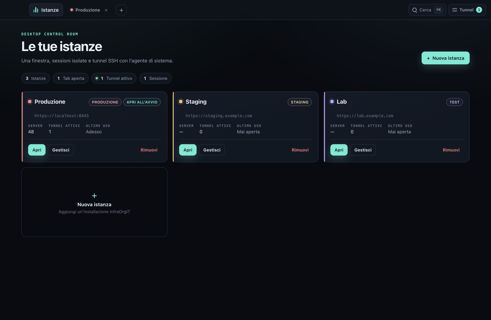
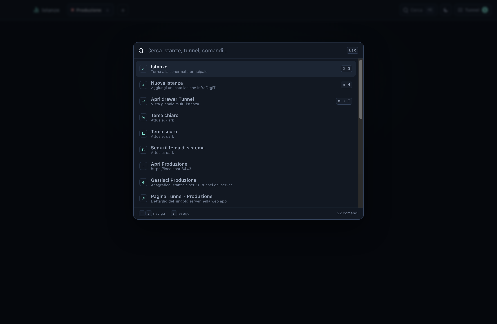
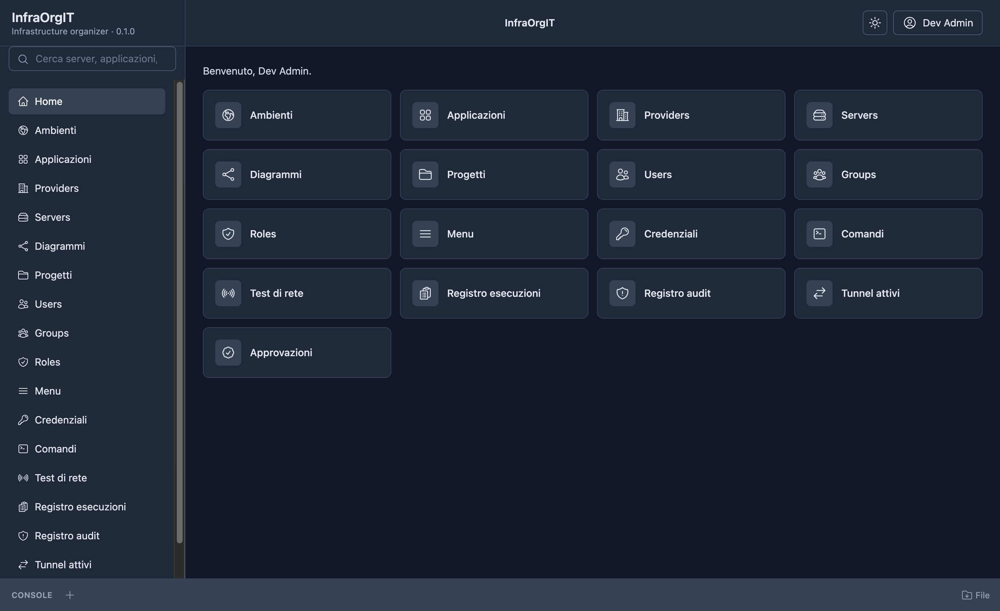
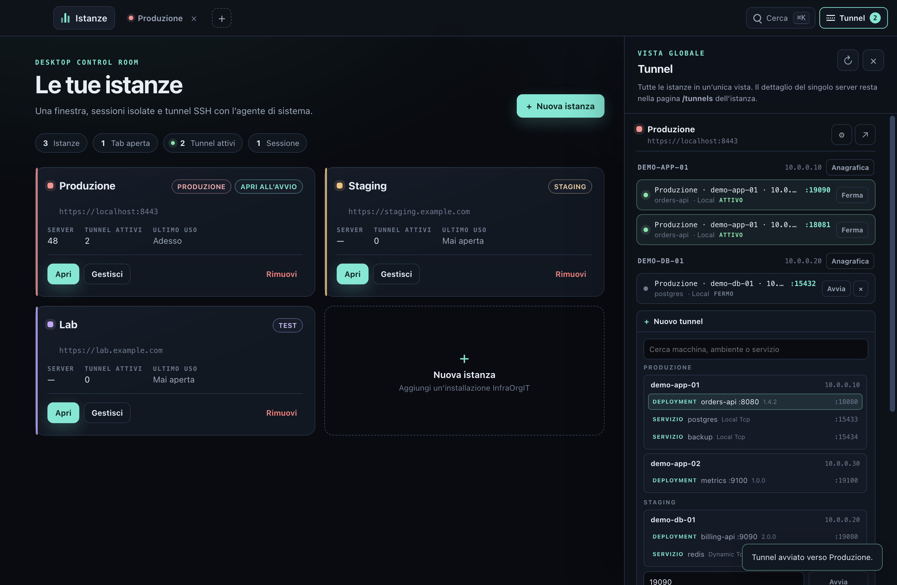
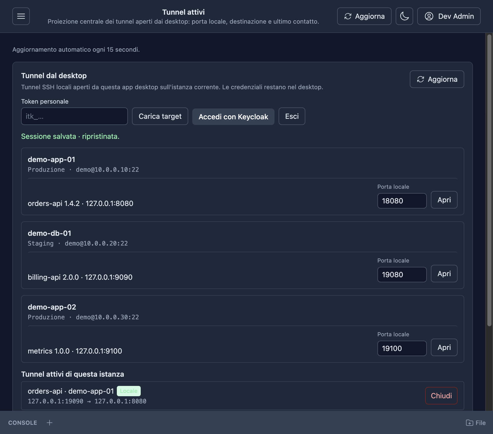

# InfraOrgIT Desktop

Electron desktop shell for InfraOrgIT. The app opens a dark control-room
manager, then each InfraOrgIT instance in its own tab of the same window. Every
instance has a persistent Chromium session partition, so cookies and the BFF
login are isolated per URL.



The screenshots use fictitious demo instances, servers and tunnels.

## Features

- **Landing manager.** Instance cards show name, URL, environment, last use,
  server count and active tunnel count. **Nuova istanza**, **Apri**,
  **Gestisci** and **Rimuovi** are in the card; **Istanze** returns home from
  any tab.
- **Instance tabs.** `+` creates a tab, switching tabs reuses the same main
  window, and **Apri all’avvio** reopens selected tabs on launch. The landing
  screen remains the manager home.
- **Persistent sessions.** Each instance URL maps to
  `persist:instance-<hash>`; cookies never cross instances. A tab is a
  `WebContentsView`, so the shell chrome stays local while the SPA keeps its
  own navigation state.
- **Silent authentication.** At startup the desktop first checks
  `/api/session` through the instance partition. If the user already signed in
  from the Web tab, that BFF session is reused for the tunnel API and no
  Keycloak page appears. Without a BFF session it performs the OAuth 2.0 device
  flow with `infraorgit-mcp-desktop` and scopes
  `openid profile email offline_access mcp:read tunnels:operate`, opens the
  verification URL in the default browser, polls Keycloak and stores only the
  refresh token. The exchange at `POST /auth/desktop-session` extends the same
  seven-day BFF session every six hours and after system resume, so the user is
  not asked to log in again while the Keycloak offline token remains valid.
  Any failure falls back to the normal login page; a revoked or expired refresh
  token clears the local session.
- **Global tunnel drawer.** All instances in one place, grouped by instance
  and server. Each row shows `istanza · server · IP · porta locale`, an
  active/stopped state, and scoped start/stop/restart actions. Starting a
  tunnel uses only the API allowlist stored for that instance; a second tunnel
  on a busy local port is rejected before `ssh` starts. Start/stop/error and a
  30-second heartbeat are also posted to the instance, so the central
  `/tunnels` page shows the same session.
- **Server tunnel anagrafica.** The drawer and the manage dialog link to the
  existing Web server page (`/servers/{id}`) and the `/tunnels` page. The
  desktop does not duplicate the tunnel-service form.
- **Connection policy.** The instance admin page `/settings` (SystemAdmin)
  chooses `Server`, `Client` or `Auto` for the whole installation; `Auto` is
  the default. The desktop reads it before opening a tunnel, console, file
  session or action:
  - `Server`: the desktop opens a loopback listener and relays each TCP
    connection over a WebSocket to `GET /api/tunnels/relay`; the API node opens
    the SSH forward with the stored server credential. Only `Local` services
    and deployment targets are relayed. Console, console audit, files and
    actions run on the API.
  - `Client`: the system `ssh`/SFTP and `ssh2` open tunnels, console, files and
    actions with the local agent; `Local`, `Dynamic` and `Remote` tunnels are
    available. No SSH connection starts from the server.
  - `Auto`: the desktop tests the first SSH hop (direct target or jump host).
    If it is reachable it uses the client for every operation; otherwise it
    falls back to the server.

  The policy is one row in the shared database, so a cluster with several API
  nodes uses the same mode everywhere. Relay connections are bound to the node
  that accepts the WebSocket; the load balancer must forward WebSocket upgrades
  and does not need sticky sessions because each local TCP connection opens
  its own relay. The central `/tunnels` page shows the transport (`Client` or
  `Server`) for every session; direct console/actions and file operations are
  also projected to the execution and audit logs.
- **Theme.** The shell inherits the account theme read from `/api/session`
  (falling back to `settings.json` before any instance is available). There is
  no desktop theme button: the Web app's toggle is the only control and cycles
  light, dark and system (the system icon follows the OS); its `theme.changed`
  message updates the shell immediately.
- **Command palette.** `Cmd+K` on macOS and `Ctrl+K` on Windows/Linux, also in
  an instance tab. It opens instances, creates an instance, toggles the tunnel
  drawer, reloads the active tab and opens tunnel URLs.
- **Downloads.** Server attachments use Chromium's native download into the
  user's Downloads folder with a unique file name; progress and completion are
  tracked per instance and shown in the management window. Generated API
  results use the blob bridge with a native save dialog. Dragging a remote file
  out of the SFTP panel uses Chromium's `DownloadURL`, which saves it through
  the same native download path.
- **Existing bridge.** The renderer still sees the narrow
  `window.infraorgitDesktop` bridge used by the download/tunnel panels of the
  Web app: `sendMessage`/`receiveMessage` of JSON strings only. No Node,
  `require`, `process` or `ipcRenderer` is exposed to the SPA.





## Silent authentication sequence

1. On startup the main process checks `/api/session` through the instance
   partition. If the user already signed in from the Web tab, that BFF session
   is reused for the tunnel API and no Keycloak page appears.
2. Without a BFF session, “Accedi con Keycloak” starts the device flow: the main
   process calls the instance discovery document, requests a device code with
   PKCE S256 and opens `verification_uri_complete` with `shell.openExternal`.
3. The renderer only receives the user code and verification URL. The device
   code, PKCE verifier, access token and refresh token stay in the main
   process.
4. After approval, the refresh token is encrypted with Electron
   `safeStorage` into `userData/desktop-auth.bin`. The file contains only
   instance URL → refresh token; access tokens are never written.
5. On the next launch the main process refreshes the token with Keycloak, then
   calls `POST /auth/desktop-session` with
   `{ "refreshToken": "…" }` using `session.fromPartition(...).fetch`
   (`credentials: "include"`). Chromium stores the BFF `Set-Cookie` in that
   instance partition, and the tab loads the SPA directly.
6. The same exchange runs every six hours while an instance tab is open and
   after system resume. The API updates the existing desktop session and
   extends its seven-day cookie, so the login page only appears when the
   Keycloak offline token is revoked, expired or unavailable.
7. `401/404/502` or a network error fall back to the normal `/auth/login`
   page. Tokens are never sent to a renderer or written to `instances.json`.

The server side is `POST /auth/desktop-session` with the public desktop client
and `GET/PATCH /api/session[/theme]`. Tunnel endpoints accept either the BFF
session or a token with `tunnels:operate`.



The per-instance Web panel keeps the local tunnel detail; the drawer is the
multi-instance view, while start/stop/error and heartbeats are projected to the
central `/tunnels` page.



## Run

Requirements: Node 24+, npm, the local full stack (`make full` from
`AllInfraOrgIT`, `https://localhost:8443`) and a trusted Caddy CA, or the
development loopback exception.

```bash
cd electron
npm install
npm start
```

In development the shell accepts the local self-signed certificate only for
loopback hosts. Packaged builds require a trusted certificate; set
`DESKTOP_ALLOW_INSECURE_LOCALHOST=1` only for an explicit local test.
`DESKTOP_USER_DATA=/path` redirects all app files (instances, settings and the
encrypted token archive).

## Tests

```bash
npm test                  # unit tests + Electron shell test (needs 8443 stack)
npm run test:unit         # fake-fetch device/session tests, stores, tunnel rules
npm run tunnel-test       # fake-ssh argument and lifecycle test
```

`npm test` writes screenshots to `test/*.png` (ignored) and exercises the real
tenant: login fallback, bridge, counts, command palette, drawer, `/tunnels`
panel, shell IPC and tab switching. The shell test seeds three fictitious
instances and a fake SSH process; it never opens a real tunnel. Set
`PROTO_USER`/`PROTO_PASSWORD` to override the local dev user.

The unit suite covers the device client (discovery, PKCE, polling,
`slow_down`, refresh, error mapping), the BFF session exchange (request body,
cookie landing, 401/404/502 fallback, no token in errors), the safeStorage
store, instance/settings persistence and duplicate local-port protection.

`test/unit` runs with `node --test` and needs no display; the shell test starts
Electron and is what `ci.yml` leaves out. CI runs the unit suite and an unsigned
package build on Linux, macOS and Windows.

## Package

The app is packaged with
[`@electron/packager`](https://github.com/electron/packager):

```bash
npm run package        # current platform and architecture
npm run package:mac    # darwin/arm64
npm run package:win    # win32/x64
npm run package:linux  # linux/x64
```

Output goes to `electron/dist/InfraOrgIT-<platform>-<arch>/`, with the app as
`InfraOrgIT.app` on macOS, `InfraOrgIT.exe` on Windows and `InfraOrgIT` on
Linux. The scripts select `assets/icon.icns`, `assets/icon.ico` or
`assets/icon.png` per platform; `python3 scripts/make-icons.py` regenerates
them from the brand mark. They enable `--asar`, overwrite an existing output
and ignore `test/`, `README.md`, `package-lock.json` and the packaging scripts;
production dependencies such as `ws` are packaged.

The `publish` workflow runs Electron Packager for all four release targets and
builds these archives:

| Platform | Archive | Contents |
|---|---|---|
| macOS Apple silicon | `InfraOrgIT-Desktop-<version>-osx-arm64.zip` | `InfraOrgIT.app` |
| macOS Intel | `InfraOrgIT-Desktop-<version>-osx-x64.zip` | `InfraOrgIT.app` |
| Windows x64 | `InfraOrgIT-Desktop-<version>-win-x64.zip` | `InfraOrgIT-win32-x64/` |
| Linux x64 | `InfraOrgIT-Desktop-<version>-linux-x64.tar.gz` | `InfraOrgIT-linux-x64/` |

Every archive is published with a `.sha256` checksum next to it. The packages
are unsigned: Developer ID signing, macOS notarization, Windows Authenticode
signing and auto-update are follow-ups, so the first launch needs the explicit
Gatekeeper or SmartScreen confirmation described in the root README.

## Structure

```
main.js                   app lifecycle, main window, WebContentsView tabs, IPC
auth/device-client.js     OAuth device flow + PKCE, injected fetch/delay
auth/session-client.js    /auth/desktop-session and /api/session contract
auth/refresh-store.js     safeStorage encrypted refresh-token file
auth/desktop-auth.js      BFF/device restore, tunnel access tokens
shell/instances.js        validation, atomic instances.json, old-list migration
shell/settings.js         atomic settings.json (theme fallback)
tunnels.js                SSH argument builder, client SSH or server relay, port guard
tunnel-projection.js      /api/tunnels start/stop/heartbeat projection
manager.html/js/css       control-room landing, tabs, drawer, palette, modal
preload.js                narrow SPA bridge, origin-gated
manager-preload.js        explicit shell IPC surface
test/                     Electron shell test, fake SSH, unit tests
```

## Security boundaries and caveats

- `contextIsolation: true`, `nodeIntegration: false`, `sandbox: true` for the
  manager, every instance view and both preloads.
- The SPA bridge is exposed only when the document origin equals the instance
  origin; Keycloak pages and external links loaded in the tab do not get it.
- External links open in the default browser. Remote instance URLs must use
  HTTPS; HTTP is accepted only for loopback development.
- The server relay accepts only a `serverId` plus an allowlisted `serviceId` or
  `serverApplicationId`; the target host and port are resolved server-side.
  `Dynamic` and `Remote` are rejected. The API checks `ServerOperator` on the
  environment, opens the SSH forward on `127.0.0.1` and relays bytes over the
  WebSocket. The stored server credential is used, not the user's agent, so
  this mode is a deliberate privilege boundary: only `Local` targets with a
  fixed host and port are reachable.
- Direct console/files/actions use `ssh2` with `SSH_AUTH_SOCK` (or the Windows
  OpenSSH named pipe), never a private key. The API returns the stored host-key
  fingerprint; the first direct connection stores it through
  `/api/remote/host-key`, and later connections reject a mismatch. The API
  still authorizes the target (`ServerAdmin` for console/files,
  `ServerOperator` for actions) and records the execution/audit rows.
- safeStorage uses the macOS Keychain / Windows DPAPI / Linux Secret Service
  backend. If Linux has no keyring (`basic_text`), the store refuses to write
  and keeps the session in memory for that run. A native keychain wrapper is
  the next hardening step; safeStorage is the deliberate compromise for this
  implementation.
- The local 8443 stack serves `/auth/desktop-session`; the startup path reuses
  the instance BFF session when present and otherwise falls back to the device
  flow. The shell test uses seeded tunnel targets so it does not need a real
  SSH server.
- Keycloak refresh-token rotation can invalidate the copy stored in the BFF
  session if the API turns on `revokeRefreshToken`; the current realm leaves
  rotation reuse enabled. If rotation is enabled, the API should return the
  rotated token to the desktop or accept the access token.
- Tunnel definitions kept as “stopped” rows live in memory only. The OS port
  can still be occupied by another process; the app guards duplicate desktop
  tunnels and lets `ssh ExitOnForwardFailure` report the rest.
- Release packages are unsigned. Developer ID signing, notarization,
  auto-update and a signed installer are follow-ups; verify the published
  SHA-256 checksum before running an archive.

## Packaging path

Release packaging uses Electron Packager (see the `package*` scripts and
`.github/workflows/publish.yml`). Keep the `preload`/IPC boundary, keep the
loopback certificate exception out of production, sign the macOS and Windows
builds before enabling auto-update, and keep the local manager page free of
remote content. Do not disable the Chromium sandbox to work around packaging.
