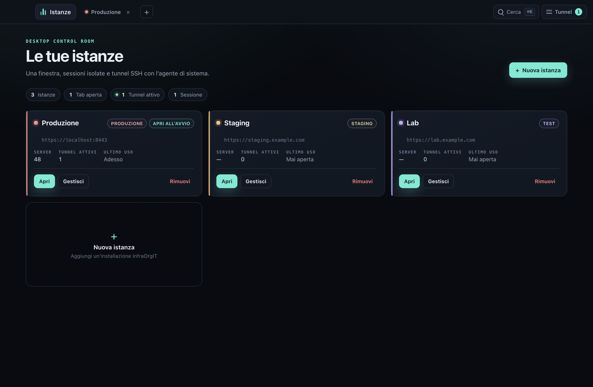
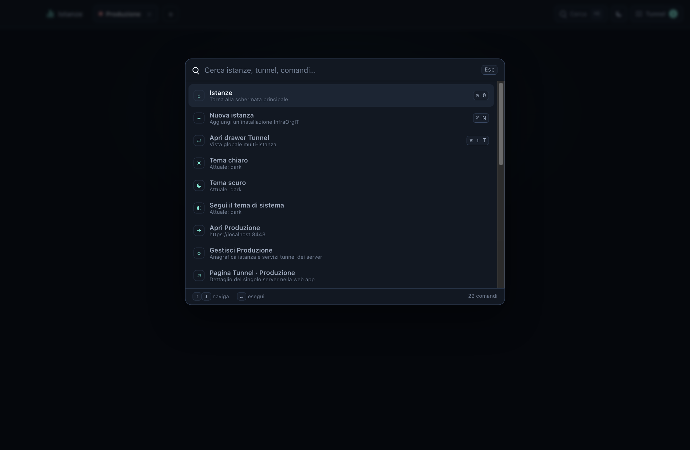
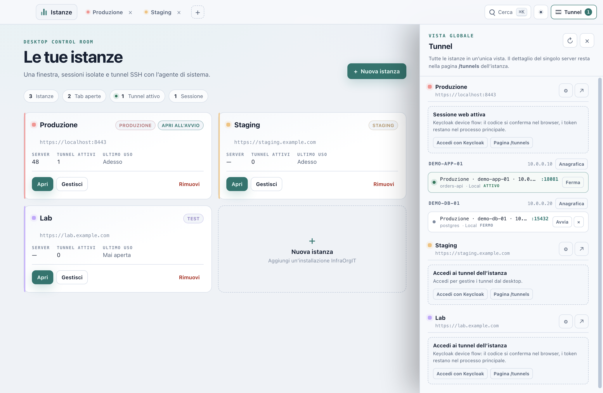
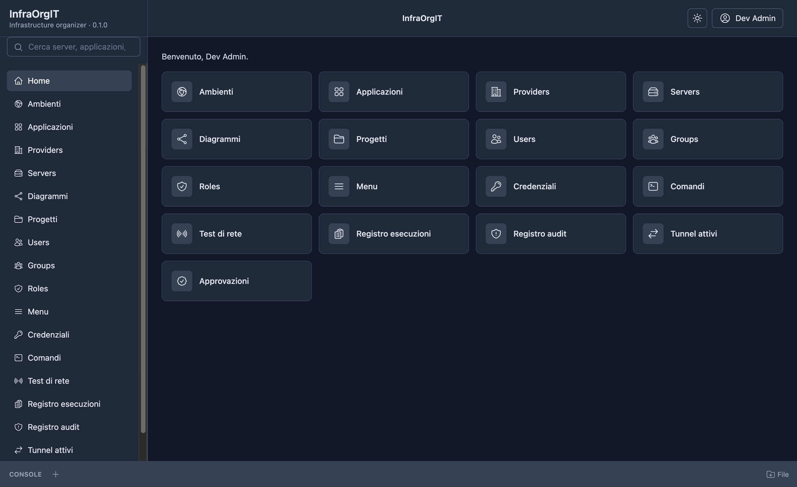
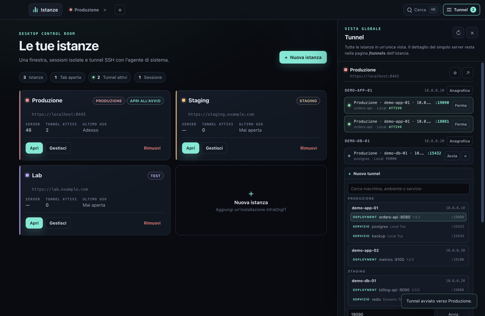
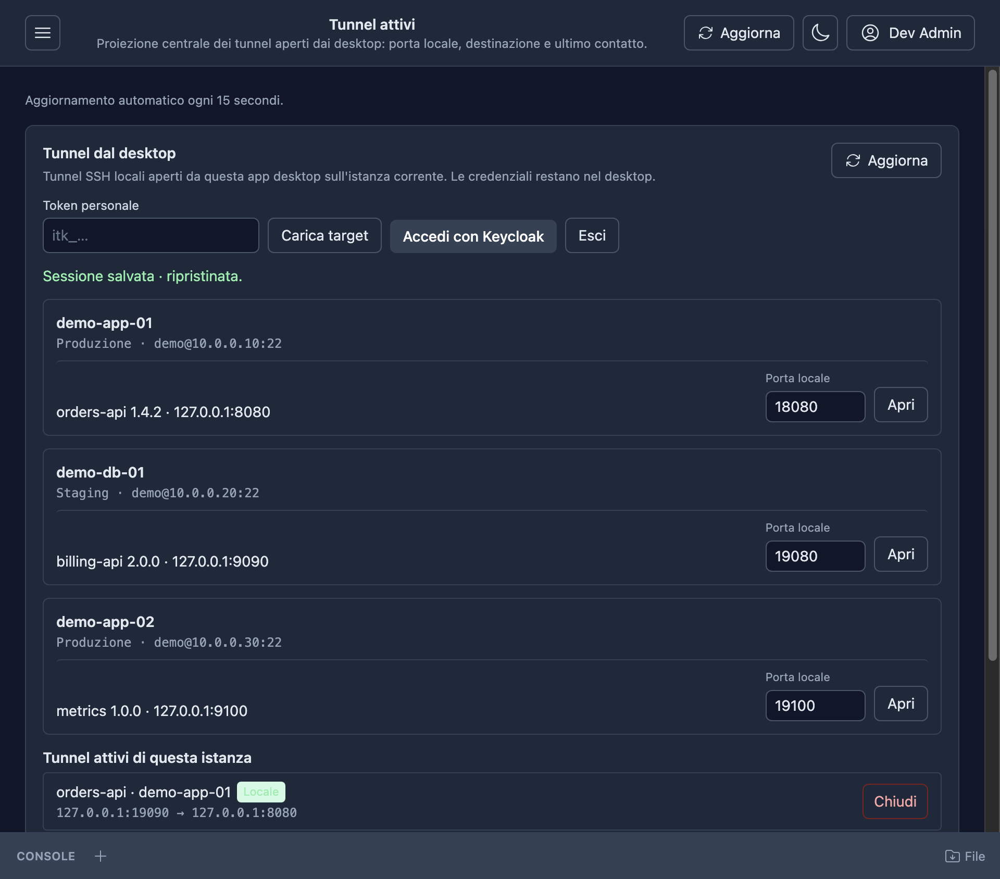

# InfraOrgIT Desktop — Electron shell

Production-intent Electron shell built on the `feat/electron-prototype`
prototype. The shell is packaged locally for testing; the Photino app under
`src/` remains the signed release until Electron signing/notarization is
completed.

The shell opens a dark control-room manager, then each InfraOrgIT instance in
its own tab of the same window. Every instance has a persistent Chromium
session partition, so cookies and the BFF login are isolated per URL.



The screenshots use fictitious demo instances, servers and tunnels.

## What this branch implements

- **Landing manager.** Instance cards show name, URL, environment, last use,
  server count and active tunnel count. **Nuova istanza**, **Apri**,
  **Gestisci** and **Rimuovi** are in the card; **Istanze** returns home from
  any tab.
- **Instance tabs.** `+` creates a tab, switching tabs reuses the same main
  window, and **Apri all’avvio** reopens selected tabs on launch. The landing
  screen remains the manager home.
- **Persistent sessions.** Each instance URL maps to
  `persist:instance-<hash>`; cookies never cross instances. A tab is a
  `WebContentsView`, so the shell chrome stays local while the SPA keeps its
  own navigation state.
- **Silent authentication.** The desktop performs the OAuth 2.0 device flow
  with `infraorgit-mcp-desktop` and scopes
  `openid profile email offline_access mcp:read tunnels:operate`, opens the
  verification URL in the default browser, polls Keycloak and stores only the
  refresh token. At startup it refreshes the token, exchanges it at
  `POST /auth/desktop-session` through the instance partition, and loads the
  SPA without the Keycloak page. While an instance tab is open (and after
  system resume) the exchange repeats every six hours and extends the same
  seven-day BFF session, so the user is not asked to log in again while the
  Keycloak offline token remains valid. Any failure falls back to the normal
  login page; a revoked or expired refresh token clears the local session.
- **Global tunnel drawer.** All instances in one place, grouped by instance
  and server. Each row shows `istanza · server · IP · porta locale`, an
  active/stopped state, and scoped start/stop/restart actions. Starting a
  tunnel uses only the API allowlist stored for that instance; a second tunnel
  on a busy local port is rejected before `ssh` starts. Start/stop/error and a
  30-second heartbeat are also posted to the instance, so the central
  `/tunnels` page shows the same session.
- **Server tunnel anagrafica.** The drawer and the manage dialog link to the
  existing Web server page (`/servers/{id}`) and the `/tunnels` page. The
  desktop does not duplicate the tunnel-service form.
- **Theme.** The shell inherits the account theme read from `/api/session`
  (falling back to `settings.json` before any instance is available). There is
  no desktop theme button: the Web app's toggle is the only control and cycles
  light, dark and system (the system icon follows the OS); its `theme.changed`
  message updates the shell immediately.
- **Command palette.** `Cmd+K` on macOS and `Ctrl+K` on Windows/Linux, also in
  an instance tab. It opens instances, creates an instance, toggles the tunnel
  drawer, reloads the active tab and opens tunnel URLs.
- **Existing bridge.** The renderer still sees the narrow
  `window.infraorgitDesktop` bridge used by the download/tunnel panels of the
  Web app: `sendMessage`/`receiveMessage` of JSON strings only. No Node,
  `require`, `process` or `ipcRenderer` is exposed to the SPA.







## Silent authentication sequence

1. On startup the main process checks `/api/session` through the instance
   partition. If the user already signed in from the Web tab, that BFF session
   is reused for the tunnel API and no Keycloak page appears.
2. Without a BFF session, “Accedi con Keycloak” starts the device flow: the main
   process calls the instance discovery document, requests a device code with
   PKCE S256 and opens `verification_uri_complete` with `shell.openExternal`.
3. The renderer only receives the user code and verification URL. The device
   code, PKCE verifier, access token and refresh token stay in the main
   process.
4. After approval, the refresh token is encrypted with Electron
   `safeStorage` into `userData/desktop-auth.bin`. The file contains only
   instance URL → refresh token; access tokens are never written.
5. On the next launch the main process refreshes the token with Keycloak, then
   calls `POST /auth/desktop-session` with
   `{ "refreshToken": "…" }` using `session.fromPartition(...).fetch`
   (`credentials: "include"`). Chromium stores the BFF `Set-Cookie` in that
   instance partition, and the tab loads the SPA directly.
6. The same exchange runs every six hours while an instance tab is open and
   after system resume. The API updates the existing desktop session and
   extends its seven-day cookie, so the login page only appears when the
   Keycloak offline token is revoked, expired or unavailable.
7. `401/404/502` or a network error fall back to the normal `/auth/login`
   page. Tokens are never sent to a renderer or written to `instances.json`.

The server side is `POST /auth/desktop-session` with the public desktop client
and `GET/PATCH /api/session[/theme]`. Tunnel endpoints accept either the BFF
session or a token with `tunnels:operate`.



The per-instance Web panel is unchanged and still lists only the active
tunnels of that instance; the drawer is the multi-instance view.



## Run

Requirements: Node 24+, npm, the local full stack (`make full` from
`AllInfraOrgIT`, `https://localhost:8443`) and a trusted Caddy CA, or the
development loopback exception.

```bash
cd InfraOrgITDesktop/prototype-electron
npm install
npm start
```

In development the shell accepts the local self-signed certificate only for
loopback hosts. Packaged builds require a trusted certificate; set
`DESKTOP_ALLOW_INSECURE_LOCALHOST=1` only for an explicit local test.
`DESKTOP_USER_DATA=/path` redirects all app files (instances, settings and the
encrypted token archive).

## Tests

```bash
npm test                  # unit tests + Electron shell test (needs 8443 stack)
npm run test:unit         # fake-fetch device/session tests, stores, tunnel rules
npm run tunnel-test       # fake-ssh argument and lifecycle test
```

`npm test` writes screenshots to `test/*.png` (ignored) and exercises the real
tenant: login fallback, bridge, counts, command palette, drawer, `/tunnels`
panel, shell IPC and tab switching. The shell test seeds three fictitious
instances and a fake SSH process; it never opens a real tunnel. Set
`PROTO_USER`/`PROTO_PASSWORD` to override the local dev user.

The unit suite covers the device client (discovery, PKCE, polling,
`slow_down`, refresh, error mapping), the BFF session exchange (request body,
cookie landing, 401/404/502 fallback, no token in errors), the safeStorage
store, instance/settings persistence and duplicate local-port protection.

## Structure

```
main.js                   app lifecycle, main window, WebContentsView tabs, IPC
auth/device-client.js     OAuth device flow + PKCE, injected fetch/delay
auth/session-client.js    /auth/desktop-session and /api/session contract
auth/refresh-store.js     safeStorage encrypted refresh-token file
auth/desktop-auth.js      startup restore, device login, tunnel access tokens
shell/instances.js        validation, atomic instances.json, prototype migration
shell/settings.js         atomic settings.json (theme fallback)
tunnels.js                SSH argument builder, process lifecycle, port guard
tunnel-projection.js      /api/tunnels start/stop/heartbeat projection
manager.html/js/css       control-room landing, tabs, drawer, palette, modal
preload.js                narrow SPA bridge, origin-gated
manager-preload.js        explicit shell IPC surface
test/                     Electron shell test, fake SSH, unit tests
```

## Security boundaries and caveats

- `contextIsolation: true`, `nodeIntegration: false`, `sandbox: true` for the
  manager, every instance view and both preloads.
- The SPA bridge is exposed only when the document origin equals the instance
  origin; Keycloak pages and external links loaded in the tab do not get it.
- External links open in the default browser. Remote instance URLs must use
  HTTPS; HTTP is accepted only for loopback development.
- safeStorage uses the macOS Keychain / Windows DPAPI / Linux Secret Service
  backend. If Linux has no keyring (`basic_text`), the store refuses to write
  and keeps the session in memory for that run. A native keychain wrapper is
  the next hardening step; safeStorage is the deliberate compromise for this
  implementation.
- The running 8443 stack does not yet serve `/auth/desktop-session`, so the
  real silent path could not be completed end to end here. The shell falls
  back to Keycloak login, which is what the shell test validates.
- Keycloak refresh-token rotation can invalidate the copy stored in the BFF
  session if the API turns on `revokeRefreshToken`; the current realm leaves
  rotation reuse enabled. If rotation is enabled, the API should return the
  rotated token to the desktop or accept the access token.
- Tunnel definitions kept as “stopped” rows live in memory only. The OS port
  can still be occupied by another process; the app guards duplicate desktop
  tunnels and lets `ssh ExitOnForwardFailure` report the rest.
- The shell has no packaging, signing, auto-update or installer yet. The
  Photino app remains the released product until this branch is accepted.

## Packaging path

Use Electron Forge or electron-builder with the same `preload`/IPC boundary,
keep the loopback certificate exception out of production, sign the macOS and
Windows builds, and keep the local manager page free of remote content. Do not
disable the Chromium sandbox to work around packaging.
